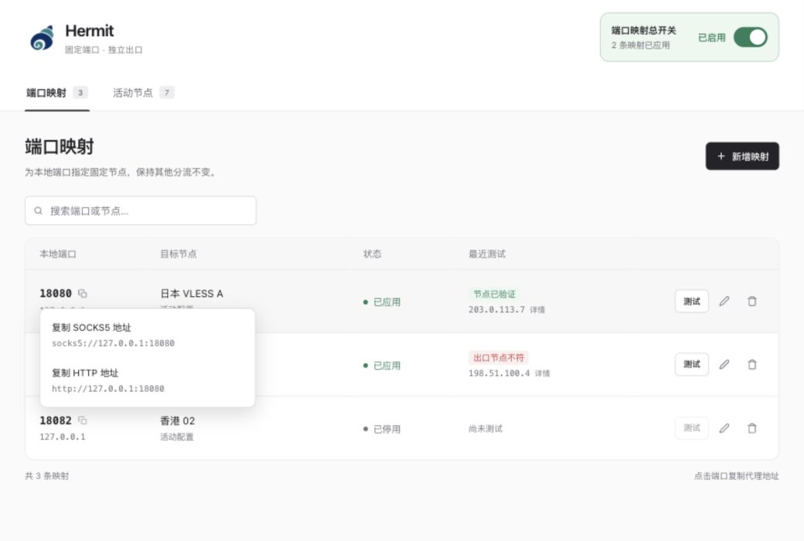

  

<h1 align="center">Hermit</h1>

为每个应用，留一个固定的代理端口。

  <a href="README.en.md">English</a> ·
  <a href="#开始使用">开始使用</a> ·
  <a href="docs/troubleshooting.md">常见问题</a> ·
  <a href="https://github.com/ruipenglu/Hermit/issues">反馈建议</a>

Hermit 是 macOS 上的 Clash Verge Rev 固定端口管理器。将本地端口绑定到指定节点，再把代理地址填入应用，就能为浏览器、命令行工具和测试环境分别设置出口，保留 Clash 原有的规则分流。

界面中的节点和 IP 均为示例数据。

## 一个端口，一个指定节点

不同应用可以使用不同的代理地址，无需反复切换同一个代理入口。例如：

| 使用场景 | 本地代理地址 | 绑定节点 |
| --- | --- | --- |
| 浏览器 | `127.0.0.1:18080` | 节点 A |
| 命令行工具 | `127.0.0.1:18081` | 节点 B |
| 测试环境 | `127.0.0.1:18082` | 节点 C |

应用需要支持手动设置 HTTP 或 SOCKS5 代理；Hermit 提供端口映射，节点和订阅由 Clash Verge Rev 管理。

## 日常操作，都在一个窗口里

- **绑定节点**：从活动节点中选择，或导入节点分享链接，为它分配本地端口。
- **复制地址**：点击端口，选择 HTTP 或 SOCKS5 格式，直接粘贴到目标应用。
- **确认出口**：就地测试连接，查看出口 IP、耗时，以及实际代理链是否经过指定节点。
- **统一开关**：开启时自动应用映射修改；关闭时恢复原脚本，并保留映射供下次使用。

支持端口与节点搜索、明暗外观，以及适合小窗口的布局。

## 开始使用

当前构建面向 **Apple Silicon Mac，最低系统目标为 macOS 13**。使用前，请启动 Clash Verge Rev 并加载可用配置。安装包尚未发布；提前体验可按 [源码构建指南](CONTRIBUTING.md#构建-macos-应用) 生成应用。

1. 打开 Hermit，点击「新增映射」。
2. 填写本地端口，选择节点，然后保存。
3. 开启「端口映射总开关」，点击端口复制代理地址。
4. 将地址填入目标应用的代理设置，点击「测试」确认出口。

总开关关闭时，「保存」只保存配置。**「保存并测试」会开启总开关，并应用所有已启用的映射。**

可导入 VLESS、VMess、Trojan、Shadowsocks、ShadowsocksR、Hysteria、Hysteria2 和 TUIC 分享链接。

## 数据与隐私

节点凭据和恢复快照在本地加密保存，密钥存放在 macOS 钥匙串。Hermit 没有内置遥测；连接测试会通过指定代理访问 `api.ipify.org`，以获取出口 IP。

启用映射会修改 Clash 的全局脚本并重载配置，停用时恢复原脚本。升级或卸载前，请先关闭映射。详细的数据说明与报告渠道见 [安全与隐私](SECURITY.md)，遇到异常可查阅 [故障排查](docs/troubleshooting.md)。

## 反馈与参与

欢迎通过 [Issues](https://github.com/ruipenglu/Hermit/issues) 反馈问题或提出建议。请提供版本、复现步骤和脱敏截图，不要上传真实订阅、节点凭据或完整配置。

[变更记录](CHANGELOG.md) · [贡献指南](CONTRIBUTING.md) · [兼容性与验证记录](PLAN.md#未验收与已知限制)

Hermit 自有代码采用 [MIT 许可证](LICENSE)。包含 Mihomo 的应用分发还需遵守 GPLv3，详见 [第三方依赖说明](THIRD_PARTY_NOTICES.md)。
